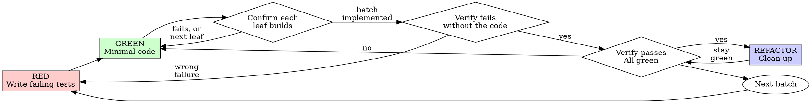

# Test-Driven Development (TDD)

## Overview

Write the tests first. Write minimal code to pass them. Then watch each test fail without that code and pass with it.

**Core principle:** If you didn't watch the test fail, you don't know if it tests the right thing.

**ECI main-path work:** the Producer's [batch procedure](../explore-critique-implement/references/implement.md#test-and-debugging-discipline) decides. For ECI main-path work, apply TDD to the new or changed tests selected as proof and the behavior they prove. Generic instructions below do not expand that selection. In a mixed batch, write only those selected new or changed tests before implementing the whole part. Running a pre-existing suite or a direct run needs no new test first. Leaves close with the ECI build check in [Batch Order](#batch-order). A new or changed test first needed because the whole-part or combined proof proved unfaithful is the one exception to the Iron Law: keep sound product code, show the test's expected RED without the tested change in a scratch export of the base and GREEN with it under testing-discipline's [Test validation](../testing-discipline/SKILL.md), then rerun the whole chosen proof. It never permits postponing initially selected tests, or implementing before an unresolved diagnosis. This precedence holds only in ECI; other workflows keep this skill unchanged.

**Violating the letter of the rules is violating the spirit of the rules.**

## Batch Order

Write the tests for all pending work in your batch, then implement it. Close each implementation leaf or plan task by confirming that its changed code builds. Its implementer may also lint that code and run tests for at most 5 seconds per run. Hold every longer test run until the whole batch is implemented, then run each new test without its code ([Verify RED](#verify-red---watch-it-fail)), then all of them ([Verify GREEN](#verify-green---watch-it-pass)). A bug's diagnosis, such as its reproduction, may run earlier.

Confirm the build by compiling or type-checking the changed code and its tests without running any test, such as `go test -run '^$' ./...`, `cargo test --no-run`, `tsc --noEmit`, or the language's equivalent. Run this check even when a lint or test run passes. Skip it for a prose-only change. Until the code that new tests reference exists, as in a tests-only task or leaf, report each check's observed result, name each failure that only that later code removes, and fix every other failure.

**ECI build check:** At implementation-leaf close, compile or type-check the changed code without running tests; skip prose-only changes. Use a fitting production target for changed production code. For changed test-only code, use the narrowest compile or type-check that includes that code and its necessary dependencies (for example, `go test -c -o <scratch-output> ./tally`). Do not require unrelated test targets. If a planned later leaf supplies code that the tests refer to, report the observed result under the missing-reference rule above. In a mixed leaf, run both checks; neither substitutes for changed code it excludes, and unchanged test targets never join the production build. A production build cannot certify unchecked test code; selected tests are still proved later in the chosen proof.

| Work | Batch |
| --- | --- |
| ECI main-path Producer | Its complete part, under ECI's [batch procedure](../explore-critique-implement/references/implement.md#test-and-debugging-discipline), which decides whether new or changed tests are written; its leaves close with the ECI build check above |
| ECI Fast Owner | Provisional Fast work need not follow this order ([fast-path](../explore-critique-implement/references/fast-path.md#fast-solving-and-delegation)); when it writes tests, one Fast issue per [checkpoint](../explore-critique-implement/references/fast-path.md#adoption-review-and-closure) |
| writing-plans plan, run by subagent-driven-development or executing-plans | The whole plan; its final task runs the tests |
| receiving-code-review | All accepted items |
| systematic-debugging | The fixes for every diagnosed bug |
| writing-skills | Every skill in the change; a pressure scenario is a test, and the skill is its code |
| deadline-ladder | The fallback, then each improvement slice, so the verified floor holds |
| Any other work | Your assignment |

## When to Use

**Always:**
- New features
- Bug fixes
- Refactoring
- Behavior changes

**Exceptions (ask your human partner):**
- Throwaway prototypes
- Generated code
- Configuration files

Thinking "skip TDD just this once"? Stop. That's rationalization.

## The Iron Law

```
NO PRODUCTION CODE BEFORE ITS FAILING TEST IS WRITTEN
```

Write code before the test? Delete it. Start over.

**No exceptions:**
- Don't keep it as "reference"
- Don't "adapt" it while writing tests
- Don't look at it
- Delete means delete

Implement fresh from tests. Period.

## Red-Green-Refactor



### RED - Write Failing Test

Write one minimal test per behavior, for all pending work, showing what should happen.

<Good>
```typescript
test('retries failed operations 3 times', async () => {
  let attempts = 0;
  const operation = () => {
    attempts++;
    if (attempts < 3) throw new Error('fail');
    return 'success';
  };

  const result = await retryOperation(operation);

  expect(result).toBe('success');
  expect(attempts).toBe(3);
});
```
Clear name, tests real behavior, one thing
</Good>

<Bad>
```typescript
test('retry works', async () => {
  const mock = jest.fn()
    .mockRejectedValueOnce(new Error())
    .mockRejectedValueOnce(new Error())
    .mockResolvedValueOnce('success');
  await retryOperation(mock);
  expect(mock).toHaveBeenCalledTimes(3);
});
```
Vague name, tests mock not code
</Bad>

**Requirements:**
- One behavior
- Clear name
- Real code (no mocks unless unavoidable)

### GREEN - Minimal Code

Write the simplest code to pass the tests.

<Good>
```typescript
async function retryOperation<T>(fn: () => Promise<T>): Promise<T> {
  for (let i = 0; i < 3; i++) {
    try {
      return await fn();
    } catch (e) {
      if (i === 2) throw e;
    }
  }
  throw new Error('unreachable');
}
```
Just enough to pass
</Good>

<Bad>
```typescript
async function retryOperation<T>(
  fn: () => Promise<T>,
  options?: {
    maxRetries?: number;
    backoff?: 'linear' | 'exponential';
    onRetry?: (attempt: number) => void;
  }
): Promise<T> {
  // YAGNI
}
```
Over-engineered
</Bad>

Don't add features, refactor other code, or "improve" beyond the test.

### Verify RED - Watch It Fail

**MANDATORY. Never skip.**

Run each new test without the code it tests, by testing-discipline's [Test validation](../testing-discipline/SKILL.md) method. Confirm:
- Test fails (not errors)
- Failure message is expected
- Fails because feature missing (not typos)

**Test passes?** You're testing existing behavior. Fix test.

**Test errors?** Fix error, re-run until it fails correctly.

### Verify GREEN - Watch It Pass

#### ECI main-path work

Confirm GREEN for the selected tests in the chosen proof. Repair scoped implementation defects; repair or replace deficient proof with equally faithful evidence. Never make unselected tests a prerequisite.

#### Other work following this skill

**MANDATORY.**

```bash
npm test path/to/test.test.ts
```

Confirm:
- Test passes
- Other tests still pass
- Output pristine (no errors, warnings)

**Test fails?** Fix code, not test.

**Other tests fail?** Fix now.

### REFACTOR - Clean Up

After green only:
- Remove duplication
- Improve names
- Extract helpers

Keep tests green. Don't add behavior.

### Repeat

Next batch: failing tests for the next pending work.

## Good Tests

| Quality | Good | Bad |
|---------|------|-----|
| **Minimal** | One thing. "and" in name? Split it. | `test('validates email and domain and whitespace')` |
| **Clear** | Name describes behavior | `test('test1')` |
| **Shows intent** | Demonstrates desired API | Obscures what code should do |

## Why Order Matters

**"I'll write tests after to verify it works"**

Tests written after code pass immediately. Passing immediately proves nothing:
- Might test wrong thing
- Might test implementation, not behavior
- Might miss edge cases you forgot
- You never saw it catch the bug

Verify RED shows each test fail without the code, proving it actually tests something.

**"I already manually tested all the edge cases"**

Manual testing is ad-hoc. You think you tested everything but:
- No record of what you tested
- Can't re-run when code changes
- Easy to forget cases under pressure
- "It worked when I tried it" ≠ comprehensive

Automated tests are systematic. They run the same way every time.

**"Deleting X hours of work is wasteful"**

Sunk cost fallacy. The time is already gone. Your choice now:
- Delete and rewrite with TDD (X more hours, high confidence)
- Keep it and add tests after (30 min, low confidence, likely bugs)

The "waste" is keeping code you can't trust. Working code without real tests is technical debt.

**"TDD is dogmatic, being pragmatic means adapting"**

TDD IS pragmatic:
- Finds bugs before commit (faster than debugging after)
- Prevents regressions (tests catch breaks immediately)
- Documents behavior (tests show how to use code)
- Enables refactoring (change freely, tests catch breaks)

"Pragmatic" shortcuts = debugging in production = slower.

**"Tests after achieve the same goals - it's spirit not ritual"**

No. Tests-after answer "What does this do?" Tests-first answer "What should this do?"

Tests-after are biased by your implementation. You test what you built, not what's required. You verify remembered edge cases, not discovered ones.

Tests-first force edge case discovery before implementing. Tests-after verify you remembered everything (you didn't).

30 minutes of tests after ≠ TDD. You get coverage, lose proof tests work.

## Common Rationalizations

| Excuse | Reality |
|--------|---------|
| "Too simple to test" | Simple code breaks. Test takes 30 seconds. |
| "I'll test after" | Tests passing immediately prove nothing. |
| "Tests after achieve same goals" | Tests-after = "what does this do?" Tests-first = "what should this do?" |
| "Already manually tested" | Ad-hoc ≠ systematic. No record, can't re-run. |
| "Deleting X hours is wasteful" | Sunk cost fallacy. Keeping unverified code is technical debt. |
| "Keep as reference, write tests first" | You'll adapt it. That's testing after. Delete means delete. |
| "Need to explore first" | Fine. Throw away exploration, start with TDD. |
| "Test hard = design unclear" | Listen to test. Hard to test = hard to use. |
| "TDD will slow me down" | TDD faster than debugging. Pragmatic = test-first. |
| "Manual test faster" | Manual doesn't prove edge cases. You'll re-test every change. |
| "Existing code has no tests" | You're improving it. Add tests for existing code. |

## Red Flags - STOP and Start Over

- Code before test
- Test written after implementation
- Test passes without the code
- Can't explain why test failed
- Tests added "later"
- Rationalizing "just this once"
- "I already manually tested it"
- "Tests after achieve the same purpose"
- "It's about spirit not ritual"
- "Keep as reference" or "adapt existing code"
- "Already spent X hours, deleting is wasteful"
- "TDD is dogmatic, I'm being pragmatic"
- "This is different because..."

**All of these mean: Delete code. Start over with TDD.**

## Example: Bug Fix

**Bug:** Empty email accepted

**RED**
```typescript
test('rejects empty email', async () => {
  const result = await submitForm({ email: '' });
  expect(result.error).toBe('Email required');
});
```

**GREEN**
```typescript
function submitForm(data: FormData) {
  if (!data.email?.trim()) {
    return { error: 'Email required' };
  }
  // ...
}
```

**Verify RED** (without the fix)
```bash
$ npm test
FAIL: expected 'Email required', got undefined
```

**Verify GREEN**
```bash
$ npm test
PASS
```

**REFACTOR**
Extract validation for multiple fields if needed.

## Verification Checklist

Before reporting the Job or outcome done:

### ECI main-path work

Confirm that the chosen proof covers every required behavior and relevant regression. For each new or changed test still selected as proof, confirm expected RED and current GREEN and apply [testing-discipline](../testing-discipline/SKILL.md).

### Other work following this skill

- [ ] Every new function/method has a test
- [ ] Watched each test fail without its code
- [ ] Each test failed for expected reason (feature missing, not typo)
- [ ] Wrote minimal code to pass each test
- [ ] All tests pass
- [ ] Output pristine (no errors, warnings)
- [ ] Tests use real code (mocks only if unavoidable)
- [ ] Edge cases and errors covered

Can't check all boxes? You skipped TDD. Start over.

## When Stuck

| Problem | Solution |
|---------|----------|
| Don't know how to test | Write wished-for API. Write assertion first. Ask your human partner. |
| Test too complicated | Design too complicated. Simplify interface. |
| Must mock everything | Code too coupled. Use dependency injection. |
| Test setup huge | Extract helpers. Still complex? Simplify design. |

## Debugging Integration

Bug found? Write failing test reproducing it. Follow TDD cycle. Test proves fix and prevents regression.

Never fix bugs without a test.

## Testing Anti-Patterns

When adding mocks or test utilities, read @testing-anti-patterns.md to avoid common pitfalls:
- Testing mock behavior instead of real behavior
- Adding test-only methods to production classes
- Mocking without understanding dependencies

## Final Rule

```
Production code → test written first and failed without it
Otherwise → not TDD
```

No exceptions without your human partner's permission.
